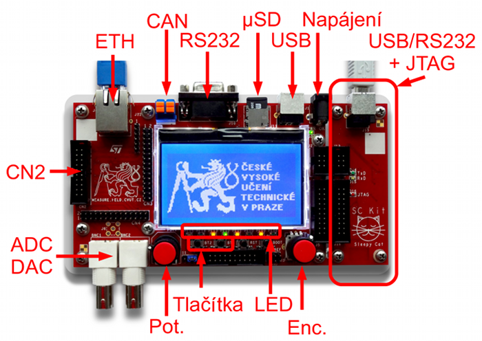
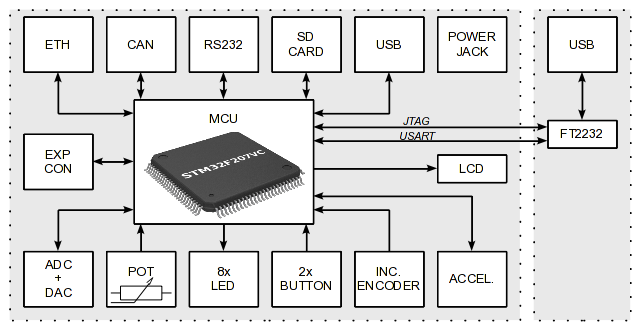

Při řešení grantu FRVŠ G1&nbsp;2011/2011 pro podporu výuky
mikroprocesorových systémů jsme vytvořili platformu Sleepy Cat. Součástí
této platformy je vývojové prostředí Sleepy Cat IDE a vývojová
deska Sleepy Cat Kit.

Vývojové prostředí Sleepy Cat IDE je založeno na platformě [NetBeans](https://netbeans.apache.org). Bylo upraveno pro potřeby vývoje
aplikací pro mikrokontrolér s&nbsp;jádrem ARM. Obsahuje vývojové nástroje [GNU Tools for ARM Embedded
Processors](https://launchpad.net/gcc-arm-embedded), [OpenOCD](https://openocd.org/).

<!--more-->

> Projekt už není aktivní a původní stránky na `pck338-242.feld.cvut.cz`
> neexistují. Instalační soubory ani vzorové projekty už stáhnout nejde.
> Tento článek je památka. Odkazy označené *(archiv)* vedou do
> [Internet Archive](https://web.archive.org/), ne na původní web.

## Proč vlastní IDE

Vývojová prostředí pro mikrokontroléry byla tehdy většinou komerční a pro
potřeby výuky měla obvykle dostatečnou verzi. Na katedře se používal
například Keil µVision.

Pro někoho zvyklého na moderní desktopová vývojová prostředí to ale byl
návrat o celou generaci zpátky. Zvýrazňování syntaxe nebo automatické
doplňování kódu, které byly na desktopu samozřejmostí už léta, tato IDE
neměla, nebo jen ve velmi chudé podobě. Podobně na tom bylo ladění: bylo
těžkopádné a ve verzích pro výuku navíc omezené. K&nbsp;tomu se přidávala další
omezení, například na velikost kódu.

Proto vzniklo Sleepy Cat IDE: moderní prostředí z&nbsp;desktopového světa,
doplněné o volně dostupné nástroje pro ARM, bez omezení velikosti kódu a
s&nbsp;plnohodnotným laděním.

Cílem bylo, aby prostředí s&nbsp;kitem fungovalo „out of the box“: nainstalovat,
otevřít vzorový projekt, přeložit, nahrát do procesoru a ladit.

## Sleepy Cat IDE

- NetBeans s&nbsp;úpravami pro vývoj v&nbsp;C (a od verze 8.2.2 i v&nbsp;C++) pro ARM.
- Kompilátor GCC z&nbsp;GNU Tools for ARM Embedded Processors, GDB a OpenOCD
  s&nbsp;vlastními úpravami (SCIDE patch).
- Nahrávání programu do procesoru a ladění přímo z&nbsp;IDE, podpora JTAG
  adaptéru Turtelizer 2, který byl součástí kitu, i ST-Link.
- Ladění s&nbsp;podporou FreeRTOS: v&nbsp;okně *Threads* byla vidět běžící vlákna.
- Od verze 8.2.4 výpis přes SWO/SWV (ITM).
- Nastavení linker scriptu a parametrů kompilace podle zvolené součástky
  (LPC23xx, LPC17xx, STM32Fxx), později i podpora STM32H7 a historického STR91.
- Nástroj `gpdsc2nb` pro převod projektu z&nbsp;STM32CubeMX (GPDSC) na projekt SC-IDE.
- Instalátor pro Windows, archiv pro Linux a DEB balíček.

### Historie verzí

| Verze | Datum | Hlavní změny |
|-------|-------|--------------|
| 001 | 15. 2. 2012 | první veřejná verze: NetBeans 7.1, GCC 4.6.1, GDB 7.2.5, OpenOCD 0.5.0 |
| 005 | 16. 3. 2012 | podpora pro Linux |
| 7.2-001 | 24. 10. 2012 | NetBeans 7.2, GCC 4.6.2, OpenOCD 0.6.1, konfigurace OpenOCD v&nbsp;projektu |
| 7.3-001 | 1. 3. 2013 | NetBeans 7.3, GCC 4.7.3 |
| 7.4-001 | 17. 10. 2013 | NetBeans 7.4, GCC 4.7.4, OpenOCD 0.7.0 |
| 7.4-004 | 12. 2. 2014 | GCC 4.8.3, podpora STM32F429 s&nbsp;flash nad 1&nbsp;MB |
| 7.4.7 | 20. 8. 2014 | OpenOCD 0.8.0, poslední verze s&nbsp;podporou SC Kitu |
| 8.2.2 | 11. 12. 2017 | NetBeans 8.2, GCC 6, OpenOCD 0.10.0, podpora C++ |
| 8.2.3 | 2. 3. 2018 | podpora STM32H7 a STR91 |
| 8.2.4 | 9. 4. 2018 | SWO/SWV přes ITM, konfigurace resetu MCU |
| 8.2.6 | 16. 4. 2018 | poslední verze: opravy pro ST-Link, nastavení optimalizace |

## Sleepy Cat Kit

Sleepy Cat Kit (SC Kit) je vývojová deska pro výuku mikroprocesorové
techniky. Základem je mikrokontrolér **STM32F207VC** (ARM Cortex-M3).

Na desce je:

- Ethernet (PHY ST802RT1A), CAN (MCP2551), RS232, USB a slot na microSD kartu,
- grafický LCD displej 128×64 (RX12864D s&nbsp;řadičem ST8565),
- dvouosý akcelerometr AIS226DS a EEPROM 24C64,
- inkrementální enkodér, dvě tlačítka, osm LED a potenciometr,
- A/D a D/A převodník s&nbsp;konektory BNC,
- expanzní konektor s&nbsp;univerzálními vstupy a výstupy.

Součástí desky je i JTAG adaptér s&nbsp;obvodem FT2232 pro programování a
ladění. Na stejné desce je převodník USB/UART pro jednoduchou komunikaci
s&nbsp;PC. Deska adaptéru byla v&nbsp;základní verzi spojená s&nbsp;hlavní deskou,
ale šla oddělit.

### Vzorové projekty

Ke kitu patřily vzorové projekty pro předmět A4M38AVS (blikání LED, UART,
enkodér, LCD, A/D a D/A převodník, akcelerometr, Ethernet, FreeRTOS) a sada
příkladů s&nbsp;FreeRTOS: HTTP server, LCD, SD karta,
[SCPI server](/software/scpi-parser/), PTP Ordinary Clock, Modbus/RTU a RTC.

Prostředí šlo použít i s&nbsp;deskami STM32 Discovery od ST. Pro STM32VL, F0,
F3, F4 a F429I-Discovery byly připravené oficiální příklady od ST převedené
na projekty SC-IDE.

## Co bylo dál

Projekt jsme řešili jako doktorandi a po odchodu jednoho z&nbsp;kolegů jsme
ho dokončili ve dvou. Tím ale život Sleepy Cat IDE neskončil.

S&nbsp;kolegou jsme ho pak ještě dlouhá léta používali pro vlastní projekty.
Ve firmách, kde jsem pracoval, na mnoho let nahradilo komerční prostředí.
Některá z&nbsp;nich byla doslova poznámkovým blokem s&nbsp;kompilátorem. Například
Ride7, se kterým jsem se v&nbsp;jedné firmě setkal ještě kolem roku 2014, mělo
jen okno s&nbsp;textem bez zvýraznění syntaxe a bez napovídání a tlačítko, které
spustilo `make` a výpis ukázalo v&nbsp;dalším okně. Ladění žádné. A prodávalo se
za peníze.

Sleepy Cat IDE jsme opustili teprve s&nbsp;příchodem
[PlatformIO](https://platformio.org/).

## Odkazy

- [Sleepy Cat IDE – původní stránka *(archiv)*](https://web.archive.org/web/20211127103754/http://pck338-242.feld.cvut.cz/scide/)
- [Sleepy Cat Kit – původní stránka *(archiv)*](https://web.archive.org/web/20230324024503/http://pck338-242.feld.cvut.cz/sckit/)
- [Popis zapojení a konektorů kitu *(archiv)*](https://web.archive.org/web/20221102210531/http://pck338-242.feld.cvut.cz/sckit/zapojeni.php)
- [Schéma zapojení, PDF *(archiv)*](https://web.archive.org/web/20200921162021/http://pck338-242.feld.cvut.cz/sckit/files/sckit-schematic.pdf)
- [Layout desky, PDF *(archiv)*](https://web.archive.org/web/20200921165235/http://pck338-242.feld.cvut.cz/sckit/files/sckit-pcb.pdf)

Projekt vznikl za podpory Fondu rozvoje vysokých škol, projekt
č.&nbsp;2011/2011 v&nbsp;tematickém okruhu G1 (tvůrčí práce studentů zaměřená na
technické obory) s&nbsp;názvem „Modernizace výuky předmětů zaměřených na
mikroprocesorovou techniku“.
