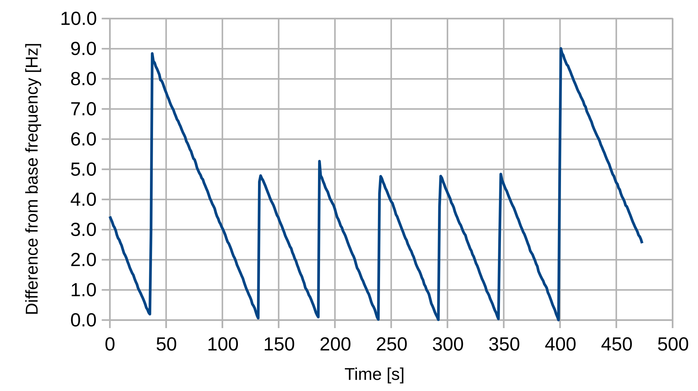

I have implemented support for Precision Time Protocol on STM32 and it still
performed badly. After some investigation, I discovered stability problems
with the HSE.

I reported these problems to ST and they confirmed this behavior, but
unfortunately, it does not appear in any errata for the STM32 line. The problem
was discovered on STM32F107 and later confirmed on STM32F207 and STM32F407.

<figure>
  
  <figcaption>STM32 HSE test connection</figcaption>
</figure>

I used several evaluation boards with ST MCUs. I just connected the HSE
internally to the MCO output of the microcontroller, so no PLL was used. The
program in the MCU just runs an infinite loop after configuring the MCO. Using
MCO also enables measurement of other clock sources, and I was able to connect
a frequency counter directly to the microcontroller.

I was measuring the frequency every second and storing it on the PC using GPIB
and SCPI. After a few minutes, there was enough data. The base frequency of the
oscillator was <em>24999407.7 Hz</em>, but it was not stable! I assumed that
only temperature drift would be visible, but that was not true. The measured
frequency was hopping by several Hz. Depending on the X-tal, these spikes were
from 2 Hz to 8 Hz.

<figure>
  
  <figcaption>STM32 HSE instability (base frequency 24999407.7 Hz)</figcaption>
</figure>

I didn't perform any tests of the HSI, but for precise time, an RC oscillator
was a no-go for me anyway.

The only solution was to use a complete external 25 MHz oscillator that was
stable enough. With the external oscillator, I was able to reach the expected
performance of the Precision Time Protocol.

Others have also confirmed this behavior: [https://blog.dan.drown.org/gps-module-measurements/](https://blog.dan.drown.org/gps-module-measurements/)
