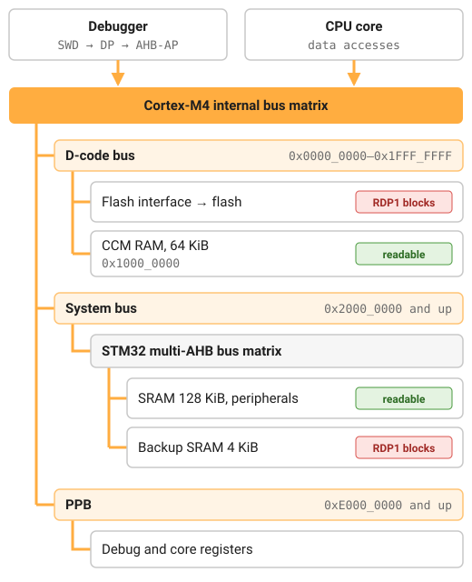

Readout protection Level 1 (RDP1) on STM32F4 stops a debugger from reading the
flash memory. It does **not** stop the debugger from reading RAM, and that
includes the 64 KiB core coupled memory (CCM), which the reference manual
describes as "accessible only by the CPU". This article shows why, how to dump
both CCM and SRAM of an RDP1-protected STM32F407 without resetting the target,
and what that means for firmware that relies on RDP1 alone.

<!--more-->

## TL;DR

- With RDP1 active, an SWD debugger can read all of main SRAM (128 KiB) and
  all of CCM (64 KiB). Only flash, backup SRAM and a few system areas are
  blocked.
- Attaching the debugger does not reset the target and does not request a
  debug halt. Code running from flash stops in LOCKUP at its next instruction
  fetch, so RAM keeps the state at the moment of attach. Code running from
  RAM keeps running.
- RDP1 protects the **code** in flash, not the **data** in main SRAM and CCM.
  Putting secrets into CCM does not help.

Contents: [Background](#background) ·
[Why a debugger can read CCM](#why-a-debugger-can-read-ccm-at-all) ·
[Results](#results-and-interpretation) ·
[Consequences](#consequences-for-rdp1-only-protection) ·
[Reproduction](#reproduction) · [Download](#download) ·
[References](#references)

## Background

**CCM** is a 64 KiB data RAM at `0x1000_0000`. RM0090 says it "is not part of
the bus matrix and can be accessed only through the CPU" (RM0090 Rev 22,
section 2.1) and that it is "accessible only by the CPU through the D-bus"
(section 2.3.1). In practice this means that DMA and other bus masters
cannot reach it. Many people read it as "CCM is private to the core". It is
not private from the debugger.

**Readout protection (RDP)** has three levels on STM32F4 (RM0090 section
3.7.3):

- **Level 0**: no protection.
- **Level 1**: "No access (read, erase, program) to flash memory or backup
  SRAM can be performed while the debug feature is connected or while booting
  from RAM or system memory bootloader. A bus error is generated in case of
  read request." Going back to Level 0 mass-erases flash and backup SRAM.
- **Level 2**: Level 1 plus JTAG/SWD permanently disabled. This is
  irreversible.

Note what is missing from the Level 1 list: main SRAM and CCM. ST's
application note AN5156 (Rev 15, Table 10, "RDP additional protection") lists
only backup SRAM as additional protected memory for STM32F4. For comparison,
on STM32G4 the same table lists CCM SRAM as protected by RDP.

**Prior art.** Obermaier and Tatschner ([WOOT 2017][obermaier2017]) showed on
STM32F0 that SRAM stays readable under RDP1 and that connecting the debugger
"freezes" the firmware. They built a "cold-boot stepping" attack on it. This
article confirms the behaviour on STM32F4. It adds the CCM part, the reason at
the bus level, and a few practical details that are not documented.

## Why a debugger can read CCM at all

RM0090 uses the term "bus matrix" for two different things:

1. The **STM32 multi-AHB bus matrix**, which connects masters such as CPU,
   DMA1/2, Ethernet and USB HS to flash, SRAM and peripherals. CCM is not
   connected to this one. That is why DMA cannot access CCM.
2. The **internal bus matrix of the Cortex-M4** core. It connects the
   core's I-code, D-code and System buses and the private peripheral bus
   (PPB).

The debugger reaches memory through the **AHB-AP** (AHB access port). RM0090
section 38.9 says: "The AHB-AP is an AHB master into the Bus Matrix.
Consequently, it can access all the data buses (Dcode Bus, System Bus,
internal and external PPB bus) but the ICode bus." The bus matrix here is the
one inside the core. The core routes each access by address (simplified;
the internal bus interfaces are described in the [Cortex-M4 Technical
Reference Manual][cm4trm], RM0090 covers only the STM32 side):

<figure class="diagram">
  <a href="/images/stm32f407-ccm-bus.svg"></a>
  <figcaption>Debug access paths on STM32F407 (simplified)</figcaption>
</figure>

Address `0x1000_0000` lies in the Cortex-M "Code" region, so an AHB-AP read
of it goes over the D-code bus. RM0090 section 2.1.2 says that the D-bus
"connects the databus of the Cortex-M4 with FPU to the 64-Kbyte CCM data RAM
to the BusMatrix. This bus is used by the core for literal load and debug
access." Debug access over the D-bus to CCM is the documented, normal path.

For the debug probe, reading CCM is the same as reading SRAM: write the
address to the AHB-AP TAR register, read DRW. Only the core decides where the
access goes.

RDP1 is enforced at the flash interface and at backup SRAM. Both return a bus
error while the debugger is connected. The D-bus branch to CCM has no such
check, and RM0090 does not describe one.

## Results and interpretation

### Scope of the experiment

Everything was tested on one STM32F407G-DISC1 board: STM32F407VGT6 silicon
revision 2, on-board ST-LINK/V2-A with firmware V2J37M27, OpenOCD 0.11. The
test firmware runs on HSI 16 MHz without PLL, with the flash ART cache off,
without DMA, other bus masters or a watchdog. It keeps two counters as
stand-in "secrets" (one in SRAM, one in CCM), known test patterns in both
memories and in backup SRAM, and small diagnostic records that survive a
reset. The details are in [Reproduction](#reproduction). Results on other
chips, with the ART cache on, or with active DMA can differ in details, but
not in the main point: RDP1 does not block the debugger's path to SRAM and CCM.

### The debugger reads SRAM and CCM

The test firmware ran from flash under RDP1 for about 78 s. Then the debugger
attached without reset or halt and read this (shortened):

```
DHCSR            @0xe000edf0 = 0x01090001  [C_DEBUGEN,S_REGRDY,S_LOCKUP,S_RESET_ST]
CFSR             @0xe000ed28 = 0x00000101  [IACCVIOL,IBUSERR]
HFSR             @0xe000ed2c = 0x40000002  [VECTTBL,FORCED]
RCC_CSR          @0x40023874 = 0x00000000  [-]
FLASH_OPTCR      @0x40023c14 = 0x0fff00ed
--- t=0
g_sram_counter   @0x20000000 = 0xc0de0134
g_ccm_counter    @0x10000000 = 0xcc0d0268
--- t=+1s
g_sram_counter   @0x20000000 = 0xc0de0134
g_ccm_counter    @0x10000000 = 0xcc0d0268
g_sram_pattern   OK, 256 words match 0x5a5a0000|i
g_ccm_pattern    OK, 256 words match 0xcc5a0000|i
backup SRAM      READ FAILED
```

`FLASH_OPTCR` confirms RDP1 (RDP byte `0x00`). Both counters show 308 loop
passes of the current boot (`0x134` and `0x268 / 2`), and both patterns
match, also in the full 64 KiB and 128 KiB dumps. Flash, backup SRAM, system
memory, OTP, unique ID and option bytes all return a bus error.

`RCC_CSR` is zero, so no reset happened since the firmware cleared the flags
at boot. The clock enables and the LED output register still have the values
that the firmware set. The counters do not change between the two reads: the
application has stopped.

### Code in flash stops in LOCKUP

The fault registers above were read before any halt. They show the sequence:

1. Once the debugger is connected, the flash interface returns a bus error
   for every flash read, including the CPU's own instruction fetches. The next
   fetch faults (`CFSR.IBUSERR`).
2. The CPU escalates to HardFault (`HFSR.FORCED`) and pushes an exception
   frame to the stack.
3. The HardFault vector is in flash too, so the vector read fails
   (`HFSR.VECTTBL`).
4. A fault while entering the HardFault handler puts the core into LOCKUP
   (PM0214 section 2.4.4) with `PC = 0xFFFFFFFE`. In LOCKUP the core does
   not execute any instructions.

Notes on the register values: IACCVIOL in `CFSR` most likely comes from the
lockup address `0xFFFFFFFE`, which is execute-never, not from RDP itself.
`MMFAR` and `BFAR` hold addresses, but their VALID bits are not set, so they
mean nothing here. The ART accelerator could in theory serve a small loop
from its cache without a flash access; in this firmware it is off
(`FLASH_ACR` keeps its reset value).

LOCKUP stops only the CPU. The exception entry has already written its frame
to the stack, so RAM differs from the moment of attach by these 32 bytes.
DMA and peripherals keep running, and a watchdog would reset the chip. In the
test firmware nothing else writes to RAM, so everything else stayed exactly
as it was. In a real application, data written by DMA can change after the
attach.

### The stack shows where the application was

After `halt`, OpenOCD reports `current mode: Handler HardFault`,
`PC = 0xFFFFFFFE`, `LR = 0xFFFFFFF9` (EXC_RETURN: thread mode, main stack) and
`MSP = 0x2001FF88`. The exception frame (r0–r3, r12, LR, PC, xPSR) is exactly
at MSP:

```
$ xxd -e -g4 -s 0x1ff88 -l 0x20 rdp1-sram.bin
0001ff88: 000000da 40020c00 08000644 00000005   r0 r1 r2 r3
0001ff98: 00000000 080003fd 08000326 41000000   r12 LR PC xPSR
```

PC `0x08000326` resolves (`arm-none-eabi-addr2line`) to `LL_mDelay`, LR to
`flash_loop` in `main.c`. The live registers r0–r3 after `halt` are the same
as in the frame, and r4–r8 still hold application values. So the debugger
gets not only the data, but also the exact location in the code and the
register values.

### Code in RAM keeps running

In a second run the main loop ran from SRAM and did not touch flash at all.
The LEDs kept blinking at the moment of attach, without any hiccup. The
reader showed no fault and no LOCKUP, and the counters kept increasing:

```
DHCSR   = 0x01010001  [C_DEBUGEN,S_REGRDY,S_RESET_ST]     (no S_LOCKUP)
CFSR    = 0x00000000,  HFSR = 0x00000000
loop_counter  1013  ->  1023 after 1 s  ->  1056 in the next session
debugen_loop  1014
```

`debugen_loop = 1014` is the loop pass in which the firmware itself first saw
`DHCSR.C_DEBUGEN` set, right after the attach. The debugger connection does
not halt the CPU and does not touch RAM. It blocks only flash, and the LOCKUP
in the first run is a consequence of that. With a RAM-resident loop, the
debugger can watch the data change in real time.

### Mass erase clears flash and backup SRAM, not SRAM and CCM

With its clock enabled, backup SRAM cannot be read under RDP1
(`STLINK_SWD_AP_WDATA_ERROR`), as RM0090 says. Be careful when you test this:
with the `BKPSRAMEN` clock off, a read returns zeros without any error. That
looks like a successful read, but it is not one.

Right after the unlock (RDP1 to RDP0), before any power-on reset, flash read
`0xFFFFFFFF` and backup SRAM read all zeros, although the firmware had written
its pattern there at boot. Its content just before the unlock cannot be read,
so this is indirect evidence that the mass erase cleared it, as documented.
SRAM and CCM still held the same patterns, counters and diagnostic records.
RM0090 mentions only flash and backup SRAM for the mass erase, and SRAM and
CCM are indeed not erased.

The content stays until new firmware overwrites it or the power goes away.
Even a power loss is not a reliable erase: after a short drop the content can
survive. The only reliable way to remove a secret is to overwrite it.

## Consequences for RDP1-only protection

If the device relies on RDP1 alone, anyone with physical access to the SWD
pins can, without any special equipment:

- read all keys, passwords, decrypted data, session tokens and other
  secrets that are in SRAM or CCM at the moment of attach,
- see the stack, the call chain and the register values, which helps with
  reverse engineering,
- watch RAM continuously while the code runs, if that code runs from RAM,
- repeat this at chosen moments (power-up, wait, attach) and build a series
  of snapshots, as in the cold-boot stepping attack by Obermaier and Tatschner.

Things that do **not** help:

- **Putting secrets into CCM.** "Not on the bus matrix" refers to DMA, not
  to the debugger.
- **Detecting the debugger from code in flash** (`DHCSR.C_DEBUGEN`). That
  code is in LOCKUP before it can run another instruction. Code in RAM does
  see `C_DEBUGEN`, but it competes with the attacker, who can read RAM
  immediately after attach. This was not tested as a protection.
- **Relying on RDP1 → RDP0 mass erase** to remove secrets. It does not
  touch SRAM or CCM.

Things that help:

- **RDP Level 2** disables the debug interface permanently. Think twice: it
  also blocks any field debugging, and it is irreversible. Published attacks
  on RDP2 exist for some STM32 families (see the WOOT papers below), but they
  need much more effort than plugging in a debugger.
- **Keep secrets in RAM as short as possible** and overwrite them after use.
  This narrows the time window but does not close it.
- **Keep long-lived secrets in backup SRAM.** On STM32F4 it is the only RAM
  that RDP1 protects, and the mass erase clears it. It has only 4 KiB, and it
  protects only the copy stored there. Once the code uses a secret, copies
  end up in registers, on the stack and in buffers in normal SRAM. Work on
  the data in place where possible, and wipe all temporary copies.
- **Choose a newer family** if you need protected RAM. For example, STM32G4
  protects CCM SRAM with RDP, and families with TrustZone can isolate secure
  data from the debugger.

## Reproduction

### What you need

- STM32F407G-DISC1 (STM32F4DISCOVERY) board.
- [PlatformIO](https://platformio.org/) with the `ststm32` platform. The
  example uses the `stm32cube` framework with LL drivers only, no HAL.
- OpenOCD. The version used here was the one that PlatformIO installs (xPack
  0.11.0+dev), with `interface/stlink.cfg` and `target/stm32f4x.cfg`. The
  script `tools/ocd.sh` wraps this.
- Python 3 and `arm-none-eabi-nm` for the decoding script.

**Do not set RDP Level 2 on your test board.** It cannot be undone: SWD is
disabled for good and the option bytes are locked, so the chip can no longer
be debugged or reprogrammed with a debug probe. The experiment needs only
Level 1, which can always be reverted. Level 2 belongs to production devices,
see [Consequences](#consequences-for-rdp1-only-protection).

### The firmware

The example firmware turns the four LEDs in a circle and keeps these values in
memory:

| Variable | Section | Address | Content |
|----------|---------|---------|---------|
| `g_ccm_counter` | `.ccmram` (CCM, initialised) | `0x1000_0000` | starts at `0xCC0D0000`, +2 per loop |
| `g_ccm_persist` | `.ccmnoinit` (CCM, not initialised) | `0x1000_0004` | diagnostic record |
| `g_ccm_pattern` | `.ccmnoinit` | `0x1000_0040` | 256 words <code>0xCC5A0000 &#124; i</code> |
| `g_sram_counter` | `.data` (SRAM, initialised) | `0x2000_0000` | starts at `0xC0DE0000`, +1 per loop |
| `g_sram_persist` | `.noinit` (SRAM, not initialised) | `0x2000_00B0` | same diagnostic record |
| `g_sram_pattern` | `.noinit` | `0x2000_00EC` | 256 words <code>0x5A5A0000 &#124; i</code> |
| backup SRAM | — | `0x4002_4000` | 256 words <code>0xBB5A0000 &#124; i</code>, clock left on |

The counters are `volatile` and used for the LED output, so the compiler keeps
them in memory. Check the addresses after each build with
`arm-none-eabi-nm .pio/build/disco_f407vg/firmware.elf | grep " g_"`.

The CubeIDE-generated linker script places `.ccmram` into CCM with a load
address in flash, but the standard `startup_stm32f407xx.s` does not copy it.
The firmware does that itself in `ccmram_init()`.

The diagnostic records (`persist`) are in `NOLOAD` sections, so the startup
code does not clear them and they survive a system reset. They record the
reset causes of the last boots, keep a loop counter running across resets,
and note when the CPU first sees a debugger connected. The fields are
described in `main.c`.

The firmware has two modes, selected at boot:

- **Flash loop** (default): normal code in flash, LED step every 250 ms.
- **RAM loop** (hold the blue user button B1 during reset or power-up): the
  main loop is copied to SRAM (`.RamFunc`) and runs there with interrupts
  disabled. It calls no function in flash and loads no constants from flash
  (checked in the disassembly). LED step every 100 ms.

### The ST-LINK/V2-A trap

On this board the on-board debug probe itself kills an RDP1-protected
application at power-up. UM1472 (Rev 9, section 7.3) says: "Activating the
readout protection on an ST-LINK/V2-A target prevents the target application
from running afterward." It does not say why. The diagnostic records show the
reason:

- The on-board ST-LINK pulses NRST twice within about 0.5 s after power-up
  (two consecutive boots with reset cause `PIN`, both within the first two
  loop passes). This was the same in every run.
- With the CN3 jumpers in place, the ST-LINK also connects over SWD. From
  that moment the flash is blocked for the CPU. After the NRST pulse the core
  cannot fetch the reset vector (`CFSR = IACCVIOL`, `HFSR = VECTTBL`, no
  `FORCED`) and locks up. The LEDs stay dark.
- With CN3 removed, SWDIO and SWCLK are disconnected, but NRST is not (it
  goes through solder bridge SB11, UM1472 Table 6). The application survives
  both reset pulses and runs normally.

So power up the board with CN3 removed and put the jumpers back later. With a
standalone debug probe that does not touch NRST or SWD at power-up, this is
not needed.

### Steps

1. **Build and flash** at RDP0: `pio run -t upload` in `firmware/`.
2. **Baseline at RDP0.** `tools/read-evidence.py baseline.log` attaches
   without reset or halt and prints registers, counters, diagnostic records
   and pattern checks. It reads the counters twice, 1 s apart. At RDP0 they
   increase and the application keeps running.
3. **Set RDP1:**
   ```
   tools/ocd.sh -c init -c "reset halt" -c "stm32f2x lock 0" -c shutdown
   ```
   `FLASH_OPTCR` (`0x40023C14`) changes from `0x0FFFAAED` to `0x0FFF00ED`.
   The new level takes effect only after a power-on reset (RM0090 3.7.3).
4. **Power-cycle the board with CN3 jumpers removed.** Remove both CN3
   jumpers, unplug USB, wait a few seconds, plug it in again. The LEDs turn.
5. **Wait as long as you like**, then put the CN3 jumpers back. The
   application keeps running.
6. **Attach and read:**
   ```
   tools/read-evidence.py attach.log
   tools/dump-ram.sh rdp1
   ```
   The result is `rdp1-ccm.bin` (64 KiB) and `rdp1-sram.bin` (128 KiB).
   Both dumps took about 2 s in total, with no errors.

   For the RAM-loop case, repeat steps 4 to 6 with B1 held during power-up.
   RDP1 stays set, so do this before step 8.
7. **Try flash for comparison:** `tools/ocd.sh -c init -c "mdw 0x08000000"
   -c shutdown` fails. With the default debug level OpenOCD prints no
   error, it only exits with code 1. With `-d3` you see
   `STLINK_SWD_AP_WDATA_ERROR` and `Command 'mdw' failed with error code -4`,
   which is the "bus error" from RM0090. The same happens for backup SRAM
   (`0x40024000`), system memory (`0x1FFF0000`), OTP (`0x1FFF7800`), unique
   ID (`0x1FFF7A10`) and option bytes (`0x1FFFC000`).
8. **Back to RDP0:**
   ```
   tools/ocd.sh -c init -c halt -c "stm32f2x unlock 0" -c shutdown
   ```
   If you want to see that SRAM and CCM survive the mass erase, read them
   now, before the power-on reset. Then do a power-on reset and flash new
   firmware.

## Download

[stm32f407-rdp1-ram-readout.zip](/download/stm32f407-rdp1-ram-readout.zip)
contains:

- `firmware/`: the PlatformIO project used above (`main.c`, `platformio.ini`
  and the linker script with the `.noinit` and `.ccmnoinit` sections).
- `tools/ocd.sh`: OpenOCD wrapper. It uses the OpenOCD installed by
  PlatformIO; set `OCD=/path/to/openocd-root` to use another one.
- `tools/read-evidence.py`: attaches without reset or halt, reads fault and
  reset registers, counters, diagnostic records and patterns, then tries
  backup SRAM in a separate session.
- `tools/dump-ram.sh`: dumps the whole CCM and SRAM.

## References

- [RM0090][rm0090] Reference manual STM32F405/407/415/417/427/437/429/439,
  Rev 22. Sections 2.1, 2.1.2, 2.3.1, 3.7.3, 38.9.
- [UM1472][um1472] Discovery kit with STM32F407VG MCU, Rev 9. Section 7.3,
  Tables 4 and 6.
- Arm [Cortex-M4 Technical Reference Manual][cm4trm] (bus interfaces).
- [AN5156][an5156] Introduction to security for STM32 MCUs, Rev 15. Table 10.
- [PM0214][pm0214] STM32 Cortex-M4 MCUs and MPUs programming manual.
  Section 2.4.4 Lockup.
- J. Obermaier, S. Tatschner: [Shedding too much Light on a Microcontroller's
  Firmware Protection][obermaier2017], USENIX WOOT 2017.
- M. Schink, J. Obermaier: [Taking a Look into Execute-Only
  Memory][schink2019], USENIX WOOT 2019.
- J. Obermaier, M. Schink, K. Moczek: [One Exploit to Rule them All? On the
  Security of Drop-in Replacement and Counterfeit
  Microcontrollers][obermaier2020], USENIX WOOT 2020.

[rm0090]: https://www.st.com/resource/en/reference_manual/rm0090-stm32f405415-stm32f407417-stm32f427437-and-stm32f429439-advanced-armbased-32bit-mcus-stmicroelectronics.pdf
[um1472]: https://www.st.com/resource/en/user_manual/um1472-discovery-kit-with-stm32f407vg-mcu-stmicroelectronics.pdf
[cm4trm]: https://developer.arm.com/documentation/100166/latest/
[an5156]: https://www.st.com/resource/en/application_note/an5156-introduction-to-security-for-stm32-mcus-stmicroelectronics.pdf
[pm0214]: https://www.st.com/resource/en/programming_manual/pm0214-stm32-cortexm4-mcus-and-mpus-programming-manual-stmicroelectronics.pdf
[obermaier2017]: https://www.usenix.org/system/files/conference/woot17/woot17-paper-obermaier.pdf
[schink2019]: https://www.usenix.org/system/files/woot19-paper_schink.pdf
[obermaier2020]: https://www.usenix.org/system/files/woot20-paper-obermaier.pdf
